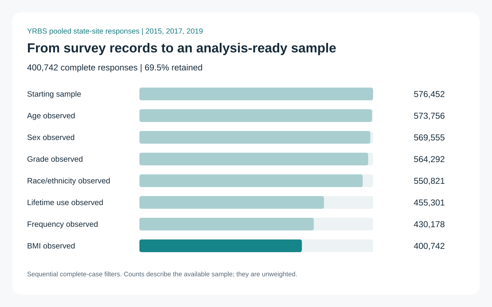

# Survey microdata: sample construction and linked policy data

**Wen Lu | Python, pandas, SQLite | Applied economics**

How do you turn several large survey exports into a sample you can actually analyze? This project makes the steps visible: check response coding, document missingness, attach state-level covariates, and verify the result in SQL.

It is a Python/SQL companion to my adolescent-health survey research, whose original econometric analysis was written in Stata. The companion was prepared in October 2026. It focuses on data preparation and validation.

**576,452 source responses → 400,742 complete responses → 43 survey sites**

[Read the case study](reports/case_study.md) · [See the Python workflow](src/survey_workflow.py) · [See the SQL](sql/sample_by_year.sql) · [My research website](https://www.wenlu.site)



## What to look at

- **Microdata preparation:** read selected fields, validate site/year/record keys, distinguish raw response categories from binary indicators, and preserve categorical age endpoints.
- **Sample accounting:** record every complete-case filter and show annual sample retention. Missing answers are not recoded to zero.
- **Data linkage:** attach tax, indoor-ban, and unemployment variables on site/year. Reject duplicate policy keys, unmatched respondents, and incomplete covariates.
- **SQL:** use CTEs, grouped counts, distinct site counts, and a join to produce annual sample summaries. Check those results against pandas.
- **Communication:** produce a short case study, a sample-flow figure, aggregate tables, and a source manifest with file checksums.

## Run it with the included example

The fixtures are **entirely synthetic**, with fictional site codes. They exercise the same cleaning, join, SQL, and reporting steps without requiring access to my local research files.

```bash
python -m pip install -r requirements.txt
python src/survey_workflow.py --demo --output demo_output
python -m unittest discover -s tests -v
```

Open `demo_output/case_study.md` to see the synthetic report. The committed `reports/` directory instead contains aggregate results from a verified run on the actual local project data.

## Reproduce the local research-data run

```bash
python src/survey_workflow.py \
  --input-root /path/to/project/data/data \
  --manifest config/legacy_exports.json \
  --output private_output
```

The local run requires the research project's CSV exports and policy workbook; these files are **not distributed here**. Anyone can run the synthetic example immediately. To rebuild from public CDC source data, use the [data guide](DATA_GUIDE.md) and map the resulting columns explicitly. Public source downloads alone do not reproduce the existing locally assembled policy workbook.

## Repository map

| File | Purpose |
|---|---|
| `src/survey_workflow.py` | Read, validate, clean, link, query, and report |
| `sql/` | SQL summaries executed by the workflow |
| `tests/test_workflow.py` | Sixteen checks, including coding and merge failures |
| `fixtures/` | Synthetic survey and policy examples |
| `config/` | Explicit input-column mappings |
| `reports/` | Aggregate outputs from the real local data run |
| `DATA_GUIDE.md` | Sources, definitions, input schema, and reproduction boundary |

## Scope

The data are pooled cross sections for 2015, 2017, and 2019. These summaries describe the available sample. They do not report national prevalence, health effects, or causal estimates. The original Stata analysis is distinct from this preparation companion. Respondent records, original unpublished manuscripts, and the locally assembled policy workbook are excluded.

The workflow was run successfully on the actual local files and on the synthetic example. SQL and pandas agreed on annual counts and site coverage.
